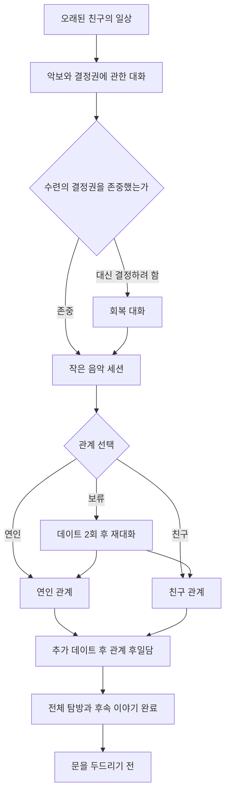

# 03. 스토리 및 관계 시스템

[전체 GDD 목차](README.md) · 기준일 2026-10-07 · v0.1

**2026-10-11 대학편 개편안:** 같은 전공·같은 학년의 친구 관계를 바탕으로 [한 학기 스토리라인](17_대학시절_스토리라인.md)과 [18장면의 새 대본](시나리오/10_대학시절_메인_시나리오.md)을 작성했다. 이 문서의 사건·ID·수치·개방 조건은 대학편 적용 전의 현재 구현이며, 새 초안의 분기 기록은 아직 저장 데이터에 포함되지 않는다.

## 이야기 구조와 진행 방식

새 게임에서는 별도 [입학·친구 관계 인트로](시나리오/11_새게임_인트로.md)를 먼저 읽는다. 5장면을 마치거나 건너뛰면 자원 변화 없이 기존 첫날로 들어간다. 인트로 진행은 주요 사건 완료·데이트 횟수와 별도로 저장하며, 아래 사건 개방 조건은 그대로다.

스토리는 **주요 관계 사건**, **반복 가능한 데이트 대화**, **탐방 후속 이야기**로 구성된다. 플레이어가 활동과 방문 경험을 쌓으면 조건을 만족한 사건이 관계 화면에 열리고, 직접 선택해 읽는다. 주요 사건의 완료 기록은 유지되며, 이후 다시 읽기로 보상을 중복 획득하지 않는다.

다음은 현재 대본의 흐름을 이해하기 위한 구분이다. 별도의 장 선택 화면이나 새 챕터 구현을 뜻하지 않는다.

| 흐름 | 이야기의 중심 | 플레이와의 연결 |
| --- | --- | --- |
| 일상의 시작 | 연습실의 친구, 함께 걷자는 약속 | 첫 대화와 첫 외출 |
| 속마음과 갈등 | 접힌 악보, 타인의 기대, 도움과 결정권의 경계 | 데이트 경험·신뢰 축적, 필요 시 회복 대화 |
| 작은 성취 | 수련이 스스로 고른 노래를 부르는 세션 | 선행 사건과 관계 조건 충족 |
| 관계의 선택 | 친구라는 말 다음의 감정 확인 | 연인 / 친구 / 보류 및 재대화 |
| 함께 넓히는 일상 | 여섯 테마의 경험, 서로 다른 마음과 취향 | 새 장소 방문과 테마별 후속 이야기 |
| 과거편 마무리 | 입사 전 자신의 다음 길을 고민하는 수련 | 전체 탐방 후 마지막 이야기 |

관계 분기는 다음처럼 이어진다.

탐방은 기본 관계 진행과 함께 시작할 수 있다. 도식의 후반 연결은 마지막 이야기까지 필요한 완료 조건을 요약한 것이다.

## 기본 관계 이야기 10편 — 구현

| ID | 이야기 | 개방 조건 / 역할 |
| --- | --- | --- |
| `hello` | 친구가 기다리는 연습실 | 처음부터 열림 |
| `space` | 비어 있는 한 칸 | 첫 대화 + 활동 기록에 일 또는 휴식. 선택적 일상 장면 |
| `invite` | 두 번 적힌 약속 | 첫 대화 + 데이트 1회 |
| `score` | 접힌 악보 | 제안 이야기 완료 + 5일 경과 + 데이트 3회 + 신뢰 15 |
| `boundary` | 아직 정하지 않은 일 | 악보 이야기 완료 + 5일 경과 + 데이트 6회 + 호감 20. 수련의 결정권에 관한 선택 |
| `repair` | 대답을 기다리는 연습 | 결정권 대화에서 대신 결정하려 한 경우. 관계 회복 |
| `session` | 다시 부르는 이유 | 결정권 확인 또는 회복 완료 + 5일 경과 + 데이트 9회 + 신뢰 30 |
| `confession` | 친구라는 말 다음에 | 세션 완료 + 5일 경과 + 데이트 12회 + 호감 40 + 신뢰 40 |
| `revisit` | 천천히 찾은 대답 | 고백 보류 후 데이트 2회 추가 |
| `epilogue` | 너와 나란한 하루 | 연인 또는 친구로 관계 확정 + 5일 경과 + 데이트 1회 추가 |

고백에서는 연인·친구·보류 중 선택한다. 보류 뒤 재대화에서 연인 또는 친구로 관계를 정할 수 있다. 모든 10편을 한 경로에서 반드시 읽는 구조는 아니다. 수치만 높이거나 날짜만 넘겨서는 선행 이야기를 건너뛸 수 없다.

기본 후드와 무료 산책으로, 열린 필수 이야기를 순서대로 읽으면 27일째(데이트 26회)에 관계 후일담에 도달한다. 보류 경로는 데이트 28회다. 주요 이야기 사이에는 5일 간격이 있고, 호감·신뢰는 높아질수록 천천히 오른다(20 미만 100%, 40 미만 50%, 60 미만 30%, 80 미만 18%, 그 이상 10%, 소수점은 이월). 2026-10-13 180일 자동 플레이 측정: 매일 데이트·선물·대화하는 플레이어는 고백 22일째·인연 10단계 48일째, 가끔 하는 플레이어는 고백 36일째·10단계 109일째. 산책 약속은 만료되지 않고 산책 완료 시 이행 기록으로 남는다.

## 탐방 후속 이야기 25편 — 구현

- 각 테마에서 서로 다른 2 / 4 / 6 / 8곳 방문 시 후속 이야기 1편씩, 총 24편을 연다.
- 같은 테마의 이전 후속 이야기를 읽어야 다음 편이 열린다.
- 테마별 3·4번째 이야기는 기본 관계 후일담 `너와 나란한 하루` 완료도 요구한다.
- 여섯 테마의 4번째 이야기를 모두 읽으면 마지막 이야기 **문을 두드리기 전**이 열린다.
- 친구와 연인 경로 모두 마지막 이야기까지 갈 수 있다. 체험 퍼즐 완성은 이야기 개방 조건이 아니다.

기본 관계 후일담과 탐방 마지막 이야기는 서로 다른 도달점이다. 기본 관계 후일담은 무료 경로로 가능하고, 탐방 마지막 이야기는 48곳 방문 및 후속 이야기 완료가 필요하다. 이야기를 마친 뒤에도 일상 플레이는 이어진다.

## 선택을 기억하는 방식 — 구현

| 기억하는 정보 | 스토리에서의 역할 |
| --- | --- |
| 호감·신뢰 | 사건 및 일부 장소의 개방 조건. 수치만으로 모든 사건을 건너뛰지는 못함 |
| 대화 선호 | 조용히 함께하기 / 서로의 하루 나누기 선택을 기록하고 회상에 사용 |
| 음악에 관한 선택 | 예전 곡을 지금의 마음으로 부르기 / 다른 곡 고르기의 선택 기억 |
| 결정권 대화 결과 | 바로 세션을 준비할지, 회복 대화를 먼저 할지 결정 |
| 관계 선택 | 연인·친구·보류 상태와 후일담 표현 결정 |
| 산책 약속 | 약속 여부와 이행 횟수 기록. 만료나 미이행 벌점 없음 |
| 사건·방문 완료 | 선행 이야기와 서로 다른 경험을 확인하여 다음 내용 개방 |

대화는 장면 설명 → 플레이어 선택 → 수련의 응답 → 다음 장면 순서로 진행한다. 선택의 영향은 대사·기억·일부 수치·후속 조건으로 표현한다. 결정권 대화에서 어긋난 선택을 해도 회복 대화가 있으며, 친구 선택을 실패 엔딩으로 취급하지 않는다.

## 실제 대본과 화면별 관계 표현

전체 장면·선택지·응답은 [시나리오 목차](시나리오/README.md)에서 읽을 수 있다. 사건과 코스의 ID는 코드와 같으며, 이 문서에는 진행 규칙을, 시나리오 폴더에는 대사 원문을 보관한다.

| 상태 | 화면에 표시하는 관계 |
| --- | --- |
| 기본, 데이트 3회 미만 | 오래 알고 지낸 친구 |
| 기본, 데이트 3회 이상 | 새로운 마음을 알아가는 친구 |
| 고백 보류 | 친구 이상의 마음을 알아가는 중 |
| 연인 선택 | 친구에서 연인으로 |
| 친구 선택 | 소중한 친구 |

새 저장은 내부적으로 `acquaintances` 값을 쓰지만 실제 설정은 오래된 친구다. 이전 저장과의 호환을 위한 값이며 낯선 사이로 시작한다는 의미가 아니다.

[조건부 회상 대사](시나리오/09_조건부_회상.md)에는 최근 데이트의 선호·코디, 약속, 관계 선택, 음악 선택에 따라 화면이 덧붙이는 문구를 별도로 정리했다.
