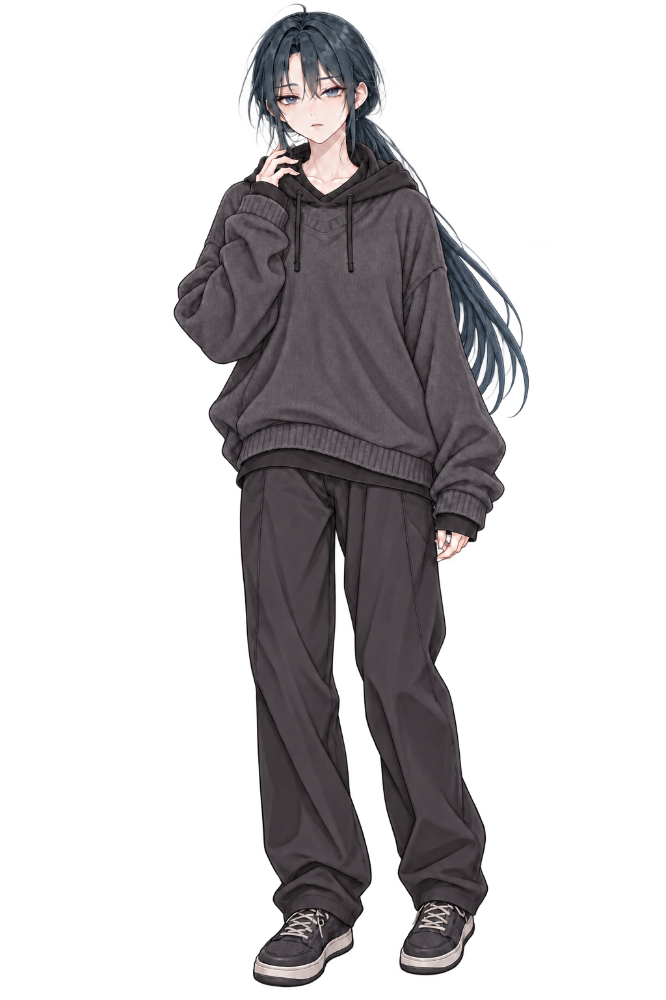
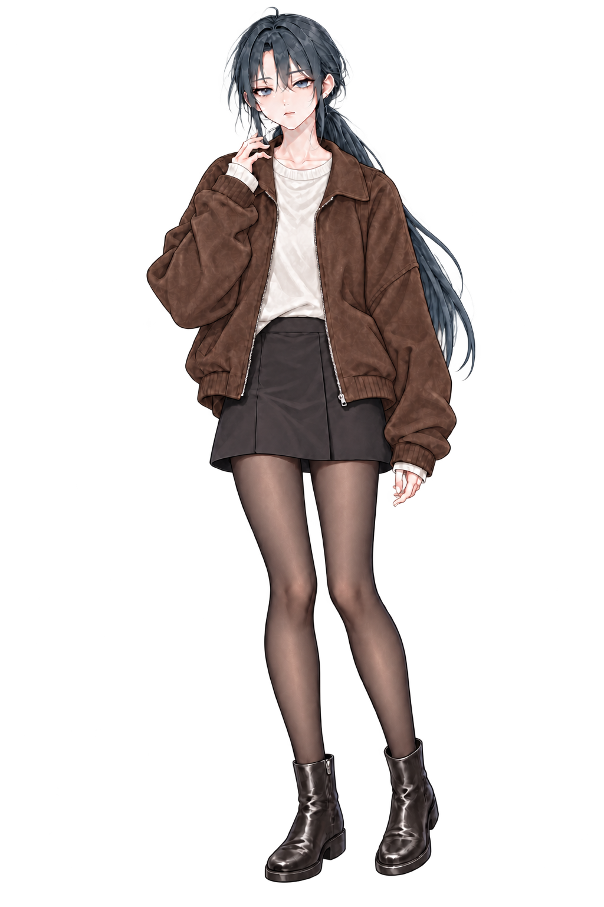
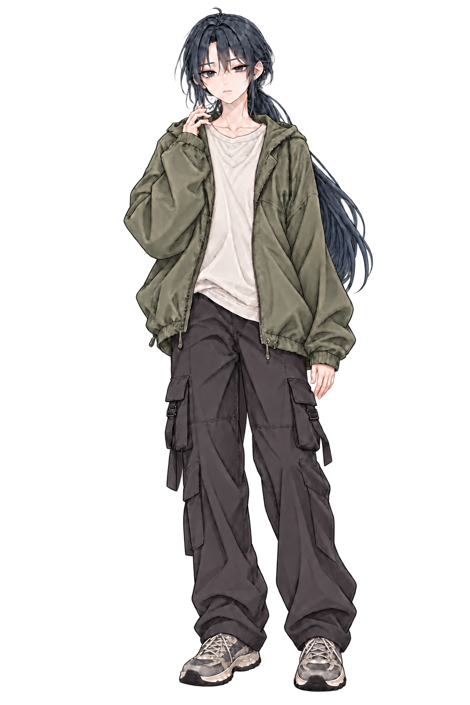
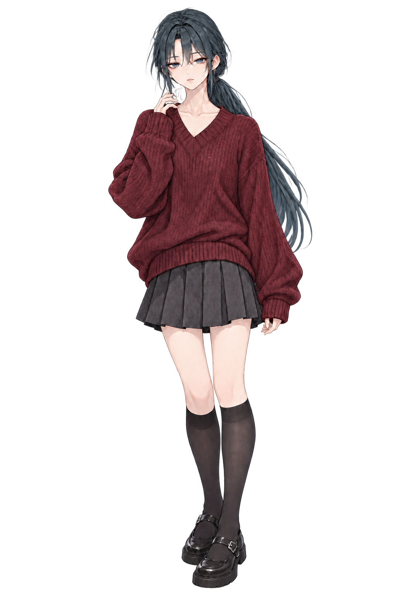
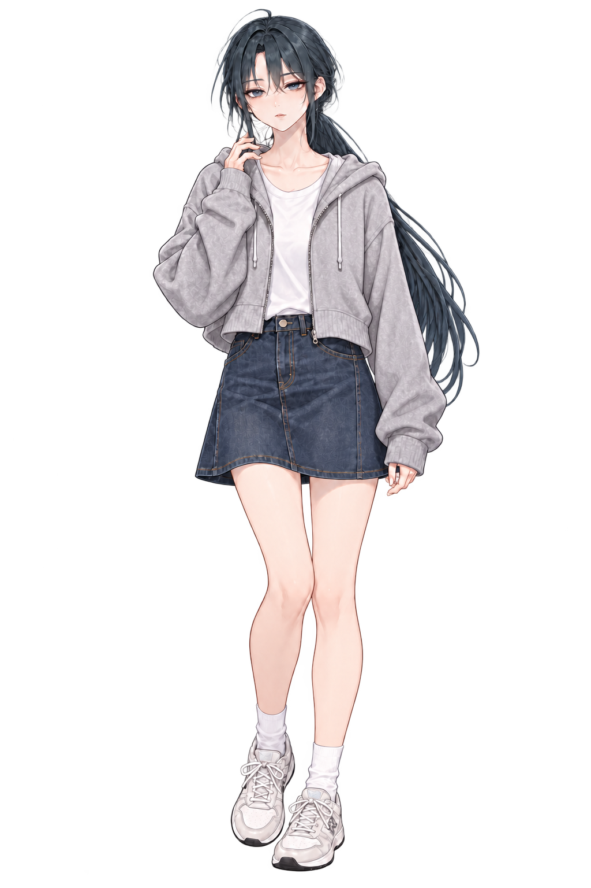
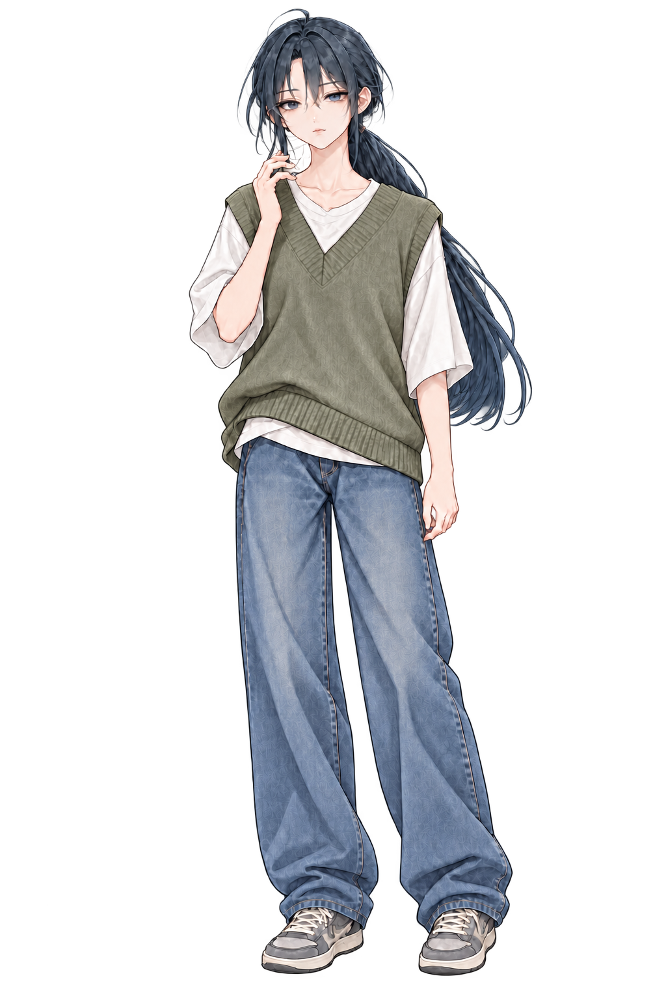
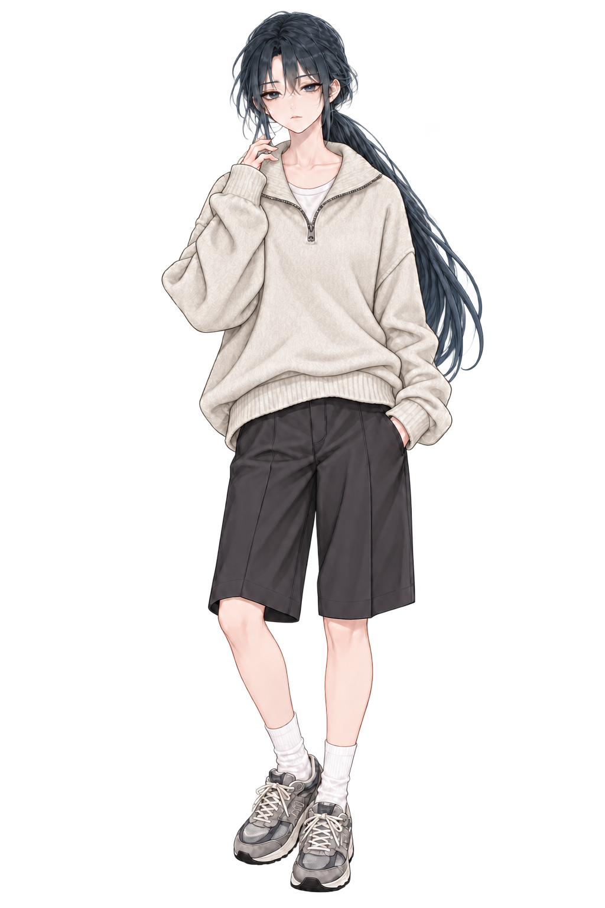
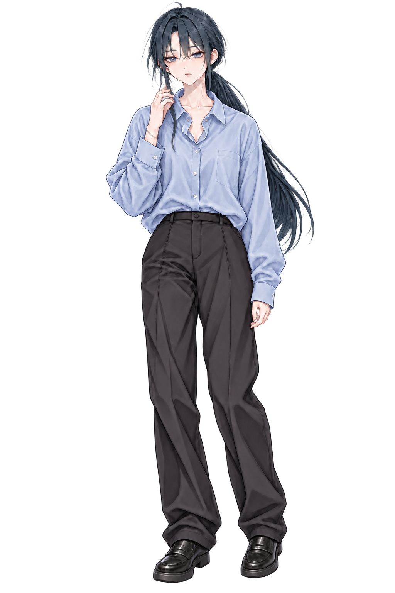
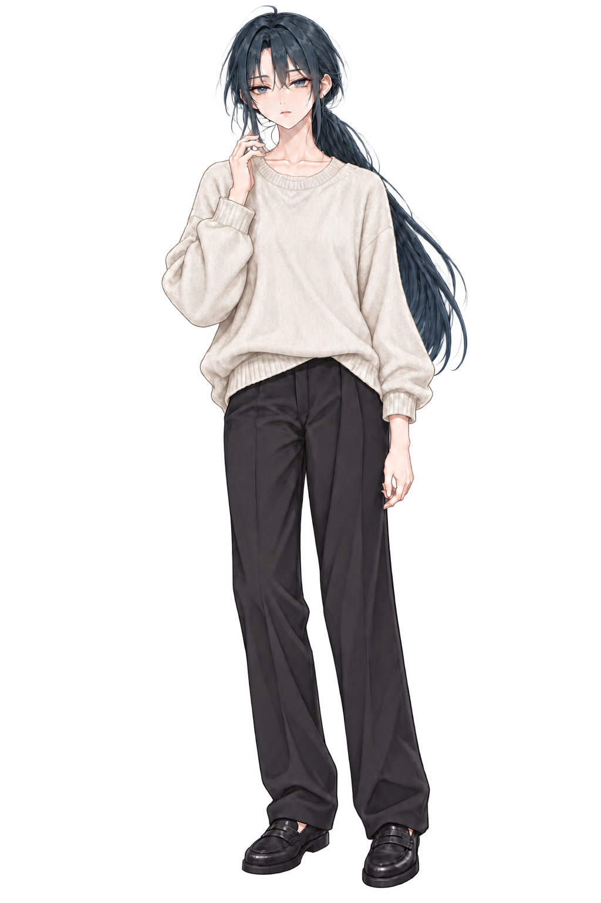
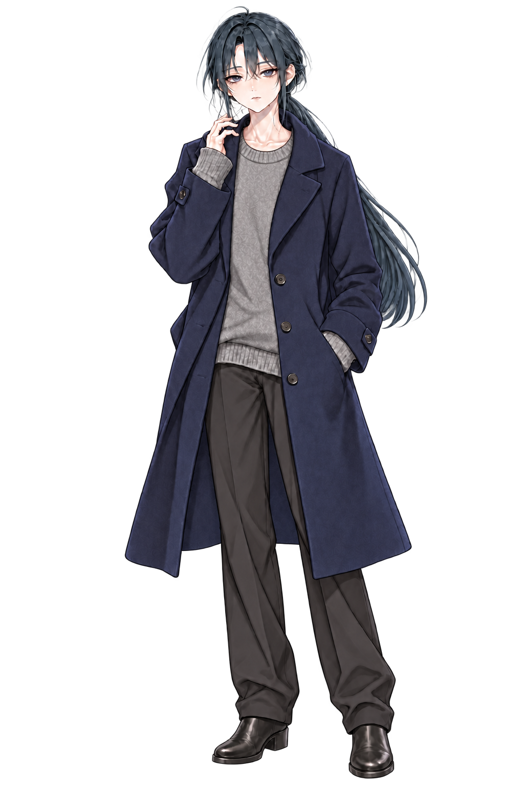

# 15. 히로인 의상 이미지

> 상태: **초안 · 검토 대기** (2026-10-27)
> 기존에 만들어 둔 전신 그림 중 **각 히로인 설정에 어울리는 옷만 골라 남겼다.** 히로인마다 2~4벌. **이 그림들은 옷만 참고한다**(0절).
> 고르지 않은 그림은 `assets/미사용/`으로 옮겼다. **미사용 폴더의 그림은 어떤 작업에도 쓰지 않는다**(4절).

## 0. 먼저 알아 둘 것

- 남긴 그림은 모두 **한 사람의 얼굴·머리(짙은 청록색 긴 머리)로 그려진 그림**이다. 그대로 세 히로인에게 쓰면 세 사람이 같은 얼굴로 보인다.
- 그래서 이 그림들은 **옷만 참고한다.** 옷의 종류 · 색 · 실루엣 · 조합(상의 · 하의 · 신발)만 가져오고, 얼굴 · 머리 · 체형 · 포즈 · 표정은 참고하지 않는다. 히로인 그림은 [11 아트와 사운드](11_아트_사운드.md#2-히로인-그림-명세-새로-제작)의 인상 · 머리 명세대로 새로 그리고, 여기 고른 옷을 입힌다.
- 파일 위치: `assets/characters/accessory-free/<옷>-<표정>.png` (1024×1536, 장신구 없는 판).

## 1. 한나리 — 4벌

> 설정: 무대 위에선 광장을 삼키고, 무대 밖에선 큰 후드에 숨는다. 밴드 보컬, 상징색 분홍. → **무대 밖 1 · 무대 1 · 합주 1 · 데이트 1**

| 옷 | 언제 입나 | 왜 어울리나 | 그림 |
|---|---|---|---|
| **큰 후드 · 와이드 팬츠** `casual` | 무대 밖 기본. 첫 만남 · 강의실 · 강변 · 루나 방송 가는 길 | 설정의 “큰 후드”와 그대로 맞는다. 몸을 숨기는 실루엣이 무대 밖의 나리 |  |
| **갈색 재킷 · 미니스커트 · 부츠** `suede-mini` | 무대 의상. 입학식 축하 무대 · 봄 대동제 · 가을 축제 | “가죽 재킷” 대신 쓸 수 있는 가장 무대다운 옷. 부츠와 검은 스타킹이 밴드 보컬의 선을 만든다 |  |
| **카키 야상 · 카고 팬츠** `utility-cargo` | 합주 · 연습실 · 여름 합숙 · 녹음실 가는 새벽 | 기타 케이스를 메고 다니는 사람의 작업복. 무대와 무대 밖의 중간 |  |
| **버건디 니트 · 플리츠 미니 · 니삭스** `mini-pleats` | 데이트 · 나리 생일(10/14) · 성탄 특집 뒤 강변 | 무대 밖인데 숨지 않는 날의 옷. 분홍 상징색과 가까운 붉은 계열 |  |

- 나리 전용으로 새로 필요한 것: **무대 웃음**(`stage`) 표정, 피크를 쥔 손, 큰 후드의 모자를 쓴 판.

## 2. 오다은 — 3벌

> 설정: 밝고 큰 몸짓, 후드 + 청바지, 드러머, 체력. 상징색 주황. → **움직이기 편한 옷만**

| 옷 | 언제 입나 | 왜 어울리나 | 그림 |
|---|---|---|---|
| **회색 후드 집업 · 데님 미니 · 운동화** `denim-mini` | 기본. 강의실 · 학생식당 · 단톡방 공지 올리는 날 | 설정의 “후드 + 청바지”에 가장 가깝다. 가볍고 시끄러운 첫인상 |  |
| **니트 조끼 · 흰 티 · 와이드 청바지** `layered-denim` | 합주 · 드럼 · 떡볶이 · 자전거 | 드럼 앞에 앉아도 편한 바지. 청바지 계열로 기본 옷과 이어진다 |  |
| **크림 맨투맨 · 버뮤다 팬츠 · 운동화** `quarter-bermuda` | 여름 · 「자전거로 끝까지」 · 생일(7/28) · 여름 합숙 | 체력 담당의 여름 옷. 운동화와 반바지로 “같이 뛰어 줄 수 있는 사람” |  |

- 다은 전용으로 새로 필요한 것: 드럼 스틱을 든 손, 손목의 스틱 테이프, 주황 포인트(머리끈·운동화 끈 등).

## 3. 백서진 — 3벌

> 설정: 24세 휴학생, 키가 크고 무뚝뚝, 카페 앞치마, 전 수영 선수. 상징색 물빛 초록. → **단정하고 군더더기 없는 옷**

| 옷 | 언제 입나 | 왜 어울리나 | 그림 |
|---|---|---|---|
| **하늘색 셔츠 · 검정 슬랙스** `shirt` | 카페 근무(앞치마를 덧그림). 첫 출근 · 마감 플레이리스트 · 창가 자리 단골 | 카페 근무복으로 바로 쓸 수 있다. 물빛 상징색과도 맞는다 |  |
| **크림 니트 · 검정 바지** `knit` | 쉬는 날 · 강변 · 「주차장이 된 수영장」 · 사장님의 케이크 | 말수 적은 사람의 편한 옷. 꾸미지 않았는데 단정하다 |  |
| **남색 롱코트 · 회색 목도리** `coat` | 겨울 · **첫눈 고백(11/25)** · 성탄 · 「수심 1m」 | 키 큰 실루엣이 가장 잘 사는 옷. 첫눈 장면의 대표 그림 |  |

- 서진 전용으로 새로 필요한 것: 카페 앞치마, 바람막이, 짧게 묶은 머리, 젖은 머리(결말).

## 4. 표정 파일 — 참고하지 않음

옷마다 표정 파일이 7종 있지만 **표정은 참고하지 않는다**(옷만 참고). 같은 옷을 여러 각도·표정으로 볼 때 옷 모양을 확인하는 용도로만 연다. 히로인 표정은 [11장](11_아트_사운드.md)의 표정 태그대로 새로 그린다. 아래는 파일 이름을 알아보기 위한 표다.

| 파일 | 표정 | 게임 태그 |
|---|---|---|
| `<옷>.png` | 기본 | `neutral` |
| `<옷>-smile.png` | 미소 | `smile` |
| `<옷>-playful.png` | 장난스러운 웃음 | `happy` |
| `<옷>-shy.png` | 수줍음 | `shy` |
| `<옷>-surprised.png` | 놀람 | `surprised` |
| `<옷>-thoughtful.png` | 생각에 잠김 | `neutral`의 변형(담담) |
| `<옷>-worried.png` | 걱정 | `sad` |
| — | 무대 웃음 · 질투 | `stage`(나리) · `jealous` — **새로 그려야 함** |

## 5. 남긴 배경

기존 배경 13장은 장소에 맞아서 그대로 남겼다(`assets/environment/`).

| 장소 | 파일 |
|---|---|
| 한강변 (아침 · 오후 · 노을 · 밤 · 타이틀) | `pier-morning` · `pier-afternoon` · `pier-evening` · `moonlit-pier` |
| 강변 카페 ‘물결’ · 학생식당 | `cafe` · `cafe-day` |
| 동아리방 (낮 · 밤) | `practice-day` · `practice` |
| 옥상 정원 (낮 · 노을 · 밤) | `rooftop-day` · `rooftop` · `rooftop-night` |
| 공연장 (작은 무대 · 큰 무대) | `acoustic-live` · `concert` |

## 6. 미사용 폴더

- 위치: `assets/미사용/` (원래 폴더 구조 그대로 옮김, 약 408MB · 파일 552개 + 보정본 2개)
- 들어간 것: 고르지 않은 옷 그림(블라우스 · 버블 미니 · 새틴 미디 · 치마 계열 등)과 그 표정들, 이전 인물 전용 그림(SD 그림 · 포즈 · 헤드셋 판 · 전신 판), 장신구 23종과 옷별 장신구 레이어, Live2D 작업 파일, 이전 인물의 방 · 옷장 배경.
- **규칙: 미사용 폴더의 그림은 기획 · 대본 · 그림 제작 · 코드 어디에도 쓰지 않는다.** 지우지는 않는다.
- 주의: 지금 실행본 코드(`src/`)는 옮긴 그림 경로 일부를 아직 가리킨다. 실행하면 그 그림이 안 보인다. 새 GDD 기준으로 코드를 바꿀 때 함께 정리한다([12장 코드 반영 필요](12_범위_로드맵_코드반영.md#5-코드-반영-필요)).
